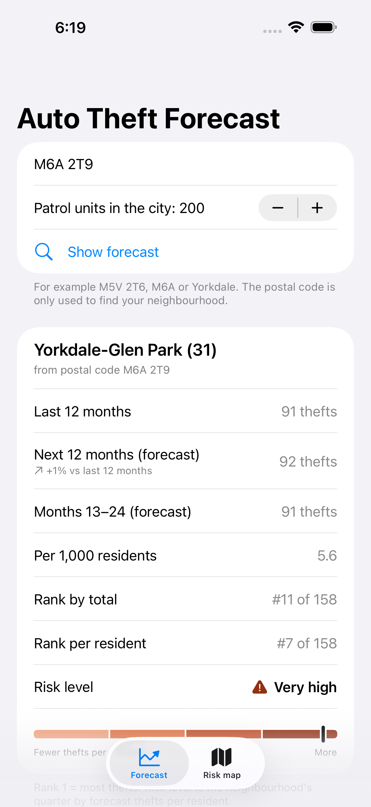
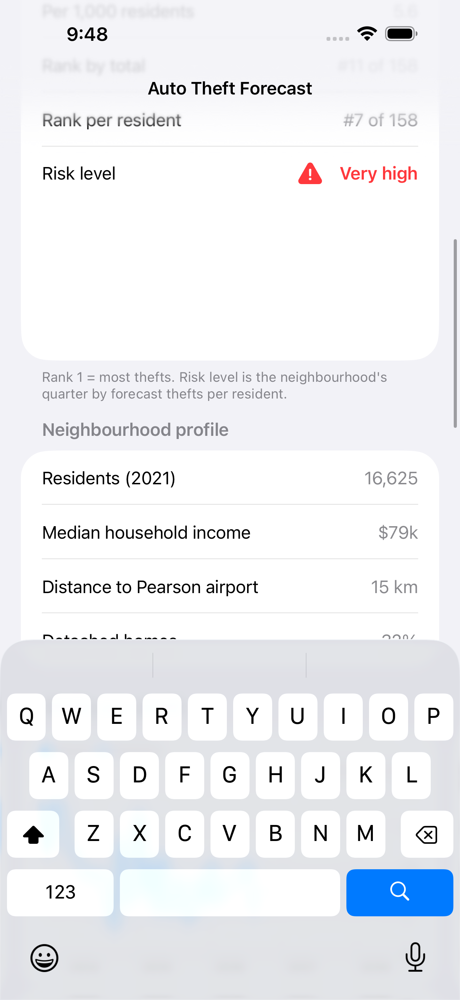
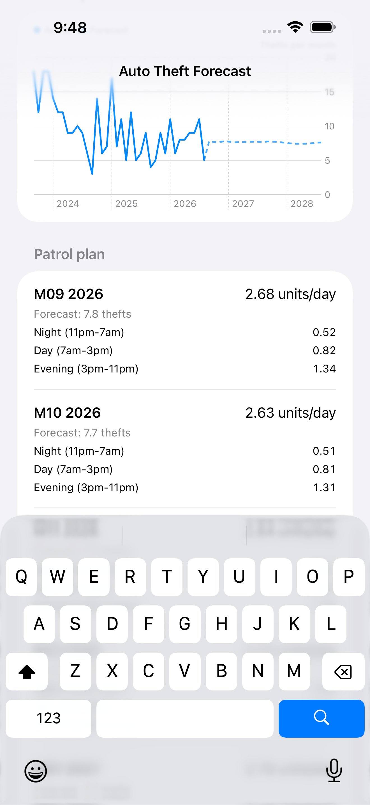

# Theft Forecast

An iOS app that forecasts auto thefts for any Toronto neighbourhood. Type a postal code
or a neighbourhood name and the app shows the next 24 months of thefts, how the area
ranks across the city's 158 neighbourhoods, a risk level, and a suggested patrol plan
by shift. The forecast runs entirely on the device using a Core ML model; the only network call is Apple's geocoder, used to turn a postal code
into a location.

## Screenshots

These screenshots come from the `ForecastFlowUITests` UI test (iPhone 17 Pro Max
simulator, test passed). The test searches for **M6A 2T9** (Yorkdale Shopping Centre)
and scrolls through the results.

| Summary | Ranks and profile | Chart and patrol plan |
|:---:|:---:|:---:|
|  |  |  |

## Key Features

- **Postal code or name lookup.** Postal codes are geocoded with Apple's CoreLocation
  and matched to a neighbourhood boundary. Names are matched by partial or closest
  spelling. The postal code is only used to find the neighbourhood, never as model input.
- **On-device forecast.** A Core ML linear model predicts thefts month by month for
  24 months, feeding each prediction back in as history.
- **Ranks and risk.** Ranks by total thefts and per 1,000 residents, plus a risk level
  (the neighbourhood's quartile), computed the same way as the notebook's pandas code.
- **Neighbourhood profile.** 2021 census figures such as residents, median household
  income and distance to Pearson airport.
- **Chart.** The last 3 years of actual thefts (solid) followed by the forecast (dashed).
- **Patrol plan.** Splits the city's daily patrol units (adjustable, default 200) by each
  neighbourhood's share of forecast thefts, then by night, day and evening shifts.

## Requirements

- Xcode with the iOS 17 SDK or later (Swift 6, strict concurrency)
- iOS 17.0 or later
- A network connection, for postal code lookup only

## Quick Start

```bash
git clone https://github.com/KunalKumarSwift/TheftForecast.git
cd TheftForecast
open TheftForecast.xcodeproj
```

Select the **TheftForecastApp** scheme, pick a simulator or device, and press Run. To run
on a device, set your own team under Signing & Capabilities.

From the command line:

```bash
# Build for a device
xcodebuild -project TheftForecast.xcodeproj -scheme TheftForecastApp \
  -destination 'generic/platform=iOS' -allowProvisioningUpdates build

# Run the UI test on a simulator
xcodebuild -project TheftForecast.xcodeproj -scheme TheftForecastApp \
  -destination 'platform=iOS Simulator,name=iPhone 17 Pro Max' test

# Run the package unit tests on the Mac (includes Core ML parity tests)
cd Packages/TheftForecastKit && swift test
```

## Project Structure

```
.
├── App/                        # App entry point: wires the engine into the UI
├── Packages/TheftForecastKit/  # All features live in this Swift package
│   ├── Sources/
│   │   ├── TheftForecastInterface/  # Models, errors and protocols shared by the others
│   │   ├── TheftForecast/           # Engine: Core ML model, forecasting, ranks, patrol plan
│   │   │   └── Resources/           # AutoTheftRegressor.mlmodel, forecast_data.json
│   │   └── TheftForecastUI/         # SwiftUI screens and view model
│   └── Tests/TheftForecastTests/    # Parity tests against the notebook's output
├── UITests/                    # End-to-end UI test that captures the screenshots above
├── docs/screenshots/           # Screenshots used in this README
└── project.yml                 # XcodeGen spec for the Xcode project
```

The UI never imports the engine. Both depend only on `TheftForecastInterface`, and the
app connects them through the `TheftForecastProviding` protocol. This keeps the screens
testable with a stub and lets the engine change without touching the UI.

The Xcode project is generated from `project.yml`. To change project settings, edit
`project.yml` and run `xcodegen generate`.

## Model and Data

The model (`AutoTheftRegressor.mlmodel`) and its data (`forecast_data.json`) are exported
by the `export_coreml.ipynb` notebook, which is not part of this repository. The app
rebuilds the notebook's 20 input variables in Swift (recent monthly counts, the
12-month average, the average of the 5 nearest neighbourhoods, the month of the year,
and fixed neighbourhood characteristics). The parity tests in `TheftForecastTests`
check that the app's forecasts match the notebook's.
